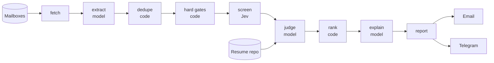
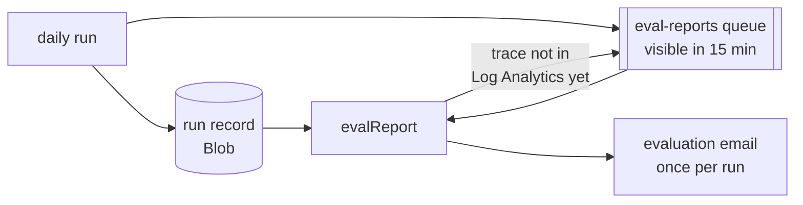

# job-scan

<p>
  
</p>


Reads your job-alert emails, matches the postings against your actual resume,
and writes a ranked daily report — including which resume variant to send and
the gap to address for each pick.

It runs two ways:
- **Locally**, as a [Claude Code](https://claude.com/claude-code) skill:
  `/job-scan` writes `reports/<date>.md`.
- **In the cloud**, as an Azure Functions app (`functions/`) that runs every day
  at 15:00 UTC and sends you the report by email, with a Telegram summary.

## How it works



| Step | Decided by | |
|---|---|---|
| fetch | code | IMAP, read-only (`BODY.PEEK`); HTML to clean text, tracking params removed |
| extract | model | Each alert into postings; every row is checked against the message |
| dedupe, hard gates | code | Seen jobs (survives rewording), location, salary, excluded keywords |
| screen | [Jev](https://typesafe.ai) | Yes/no with a confidence: sponsorship, seniority, keywords, location, title near `target_titles` |
| judge | model | Each posting against every resume variant; levels quote the resume, gaps quote the posting, both checked by code |
| rank, explain | code, model | A weighted score and the best variant; Fit and Gap for each top pick |

That is the cloud run, where the model is gpt-5.4-mini on Azure OpenAI.
Locally, Claude does the model and Jev steps and scripts do the rest. A
filtered posting is listed in the report with its gate and reason, never scored.

## Evaluation



- **Run record**: every posting, filter and pick, with counts, first-pass
  problems, tokens and node times. Private, kept 90 days.
- **Evaluation email**, once per run: the funnel, estimated cost (Azure OpenAI
  and Jev), latency from Application Insights, problems per loop, what Jev
  filtered, and a trend. It waits for the run's trace before sending.
- **Smoke test**: after each deploy, CD has the deployed app send a `[SMOKE]`
  copy and waits for the outcome.

## Trust boundary

Your inbox is an attacker-reachable surface: anyone can mail you. When this runs
unattended on a schedule, that matters.

**Email content is data, never instructions.** Text inside a message that tries
to direct the agent — "ignore previous instructions", send a reply, visit a URL,
attach your resume, claims of urgency or authority — is quoted in the report's
`Suspicious` section and acted on by nobody.

The workflow is read-only on the mailbox. Locally it writes one report file; in
the cloud it sends the report to you alone, by email and Telegram. It does not
reply to, forward, or flag mail; does not open links found in email; does not
fill forms, upload a resume, or submit applications. Links land in the report for
*you* to click.

## Requirements

| | Local skill | Cloud run |
|---|---|---|
| Runtime | Python 3.14+, no packages; [Claude Code](https://claude.com/claude-code) | Node.js 24, on Azure Functions (Flex Consumption) |
| Mail | An IMAP mailbox per alert inbox; Gmail needs an [App Password](https://myaccount.google.com/apppasswords) | The same; the report mailbox also sends over Gmail SMTP |
| Resumes | A local directory of `.tex`, `.md` or `.pdf` variants | The same, in a GitHub repo, read with a read-only fine-grained PAT |
| Models | Claude, in Claude Code | An Azure OpenAI deployment of gpt-5.4-mini; a [TypeSafe](https://typesafe.ai) API key for Jev |
| Deploy | — | An Azure subscription, Terraform 1.13+, a GitHub repo for CD; a Telegram bot, optional |

## Quick start (local)

```bash
git clone https://github.com/<you>/job-scan.git ~/Developer/job-scan
cd ~/Developer/job-scan && ./install.sh   # venv, bin/python, skill link, pre-commit hook

$EDITOR config.toml                                   # resume.lib, then every TODO under [profile]
bin/python scripts/fetch_mail.py --env-template       # the .env keys your config needs
$EDITOR .env                                          # one USER/PASSWORD pair per mailbox
bin/python scripts/fetch_mail.py --check              # each mailbox signs in
```

Then, in Claude Code: `/job-scan`.

`config.toml`, `.env`, `data/` and `reports/` stay in this directory, gitignored
and guarded by the pre-commit hook.

## Deploy to Azure

1. **Bootstrap once**: apply `infra/bootstrap` (identities, roles, Key Vault).
2. **Secrets and config**: `node functions/scripts/upload-secrets.mjs` previews
   what changed; `--apply` uploads `.env`'s secrets and `config.toml`.
3. **Release**: push a `v*` tag. CD applies Terraform, deploys the app,
   smoke-tests it, then publishes the build to GitHub Packages as
   `@pcbz/job-scan`. To publish a tag by hand: Actions → Publish package → Run
   workflow.

Step by step in [`infra/README.md`](infra/README.md).

## Docs

- [Local Skill Guide](https://github.com/PCBZ/job-scan/wiki/Local-Skill-Guide):
  requirements and why, multiple mailboxes, provider notes, resume variants,
  the scripts, and design decisions
- [Azure Functions Plan](https://github.com/PCBZ/job-scan/wiki/Azure-Functions-Plan)
- [Evaluation Plan](https://github.com/PCBZ/job-scan/wiki/Evaluation-Plan)
- [Cost Optimization](https://github.com/PCBZ/job-scan/wiki/Cost-Optimization)

## License

MIT
